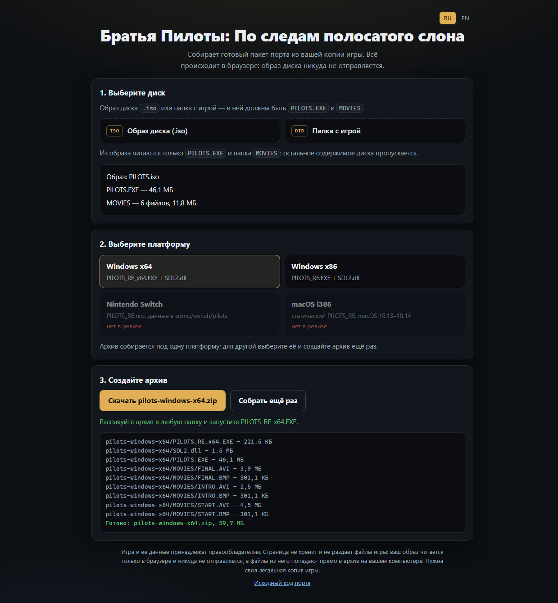

# pilots-installer

Браузерная страница подготовки дистрибутива порта «Братья Пилоты: По следам полосатого слона».

Страница берёт ваш образ диска, читает из него `PILOTS.EXE` и папку `MOVIES`, добавляет к ним
бинарник порта для выбранной платформы и отдаёт готовый архив. Всё происходит в браузере: образ
никуда не отправляется, а сервер отдаёт только саму страницу и бинарники порта.



## Что собирается

| Платформа | Архив | Содержимое | Куда распаковывать |
|---|---|---|---|
| Windows x64 | `pilots-windows-x64.zip` | `PILOTS_RE_x64.EXE`, `SDL2.dll`, данные игры | любой каталог |
| Windows x86 | `pilots-windows-x86.zip` | `PILOTS_RE.EXE`, `SDL2.dll`, данные игры | любой каталог |
| Nintendo Switch | `pilots-switch.zip` | `PILOTS_RE.nro`, данные игры | корень карты памяти (`sdmc:`) |
| macOS i386 | `pilots-macos-i386.zip` | `PILOTS_RE`, данные игры | любой каталог |

«Данные игры» — это `PILOTS.EXE` (оригинальный, с дописанными в хвост данными) и папка `MOVIES`
целиком, включая `.BMP`: движок ищет и их. Остальное содержимое диска (`DEMO/`, `WIN32S/`,
`AUTORUN.*`, `GMW.DLL`) не читается и в архив не попадает.

Linux в списке нет: сборка динамически линкуется с SDL2 и ffmpeg, и пакет без этих `.so` не
запустится. macOS — только i386 (10.13–10.14), потому что движок хранит адреса в 32-битном `int`.

## Требования

> [!NOTE]
> Нужна своя копия игры: образ диска с `PILOTS.EXE` и папкой `MOVIES`. Страница не хранит и не
> раздаёт файлы игры, она только читает ваш образ у вас в браузере.

Образ — ISO 9660 (штатный диск 1C, 1997). Подойдёт и просто папка с игрой, если диск уже
распакован. Браузер — любой современный с File API; `crypto.subtle` (проверка SHA-256 бинарников)
требует https или `localhost`, поэтому страница не работает, если открыть `index.html` двойным
щелчком.

## Как пользоваться

1. Выберите образ диска (`.iso`) или папку с игрой. Страница покажет, что нашла: размер
   `PILOTS.EXE`, число файлов в `MOVIES`, — и предупредит, если это не тот файл.
2. Выберите платформу. Недоступные платформы видны сразу: для них в релизе нет файлов.
3. Нажмите «Создать архив». Архив скачается обычным файлом; для другой платформы выберите её и
   создайте ещё раз.

## Как это работает

- **ISO 9660 без Joliet.** Образ не загружается в память: читаются только сектора каталогов
  (`lib/iso.js`), а каждый нужный файл остаётся срезом `Blob` исходного образа.
- **ZIP без сжатия** (`lib/zip.js`). Данные игры уже сжаты LZSS внутри `PILOTS.EXE`, а бинарники и
  AVI сжимаются плохо, поэтому deflate только тратил бы время. Байты файлов не копируются: срез
  образа кладётся в архив как есть, потоком считается только CRC-32.
- **Бинарники — из релиза.** `release/manifest.json` перечисляет файлы каждой платформы и их
  SHA-256; страница скачивает их и сверяет хеш перед упаковкой.
- **Права файлов.** Бинарникам проставляется режим `0755` в старшем слове внешних атрибутов ZIP:
  macOS и Linux понимают его, Windows — нет.

## Публикация

Страница статическая, сборки нет: GitHub Pages отдаёт её из корня ветки `main`
(Settings → Pages → Deploy from a branch → `main` / `/ (root)`). Файл `.nojekyll` уже лежит —
без него Jekyll может тронуть файлы, начинающиеся с подчёркивания.

## Релиз бинарников

Странице нужны файлы релиза и манифест с их хешами.

1. Соберите платформы (см. `AGENTS.md` в `pilots_re`) и разложите файлы по каталогам.
2. Соберите манифест:

   ```sh
   node tools/manifest.mjs --version 0.1.0 \
     --base https://github.com/kasru/pilots_re/releases/download/v0.1.0/ \
     --win-x64 dist/x64 --win-x86 dist/x86 --switch dist/switch --macos-i386 dist/mac
   ```

   Скрипт берёт файлы из каталогов под локальными именами (у SDL2 это просто `SDL2.dll`), считает
   SHA-256 и пишет `release/manifest.json`.
3. Загрузите файлы в релиз **под именами из манифеста**:

   | Платформа | Файлы релиза |
   |---|---|
   | Windows x64 | `PILOTS_RE_x64.EXE`, `SDL2-x64.dll` |
   | Windows x86 | `PILOTS_RE.EXE`, `SDL2-x86.dll` |
   | Nintendo Switch | `PILOTS_RE.nro` |
   | macOS i386 | `PILOTS_RE` |

   Два `SDL2.dll` (x86 и x64) в одном релизе столкнулись бы по имени, поэтому в релизе у них
   суффикс, а внутри архива они снова становятся `SDL2.dll`.
4. Закоммитьте `release/manifest.json` — страница читает его при загрузке.

Манифест без платформы означает «этой платформы в релизе нет»: карточка на странице гаснет, и
собрать её нельзя. Так что выпускать платформы можно по одной.

## Локальная проверка

Без опубликованного релиза страницу проверяют так:

```sh
node tools/dev.mjs
```

Скрипт собирает `dev/manifest.json` из соседнего репозитория `pilots_re`
(`SRC/out/x64`, `SRC/out/x86`, `build-switch-dbg`, `build-mac32` — что найдётся), раскладывает
бинарники в `dev/assets`, отдаёт `PILOTS.iso` из `pilots_re` и печатает адрес с
`?manifest=dev/manifest.json`. Каталоги можно переопределить ключами `--win-x64 <каталог>` и т. д.

Проверка самого конвейера без браузера:

```sh
node tools/test.mjs
```

Скрипт читает настоящий образ, собирает пакеты всех четырёх платформ и разбирает архивы обратно —
сверяет имена, размеры и CRC-32. Готовый архив он кладёт в `dev/test/` для проверки сторонними
распаковщиками.

## Структура

| Файл | Назначение |
|---|---|
| `index.html`, `style.css` | Разметка и оформление, три шага |
| `app.js` | Выбор источника, платформ, прогресс и скачивание |
| `lib/iso.js` | Чтение ISO 9660 (образ или папка) |
| `lib/zip.js` | Писатель ZIP без сжатия (CRC-32, права файлов) |
| `lib/installer.js` | Платформы, проверка игры, релиз, сборка архива |
| `lib/i18n.js` | Тексты на русском и английском |
| `release/manifest.json` | Версия, каталог релиза и SHA-256 файлов |
| `tools/` | Манифест, локальный сервер, проверка конвейера |

## Лицензия

Код страницы — MIT (`LICENSE`). Игра и её данные принадлежат правообладателям (Gamos, Студия
«Пилот», издатель 1C); в этом репозитории их нет, страница получает их только из вашего образа.
Проект не связан с правообладателями.
